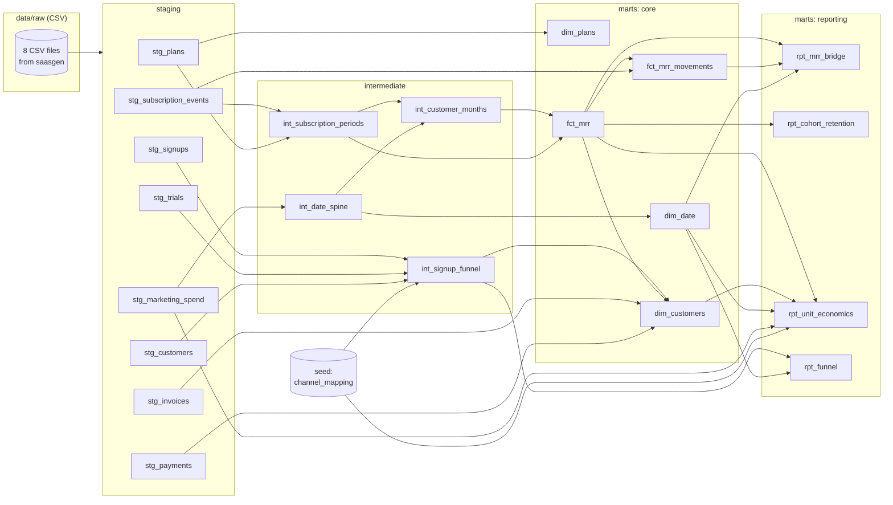
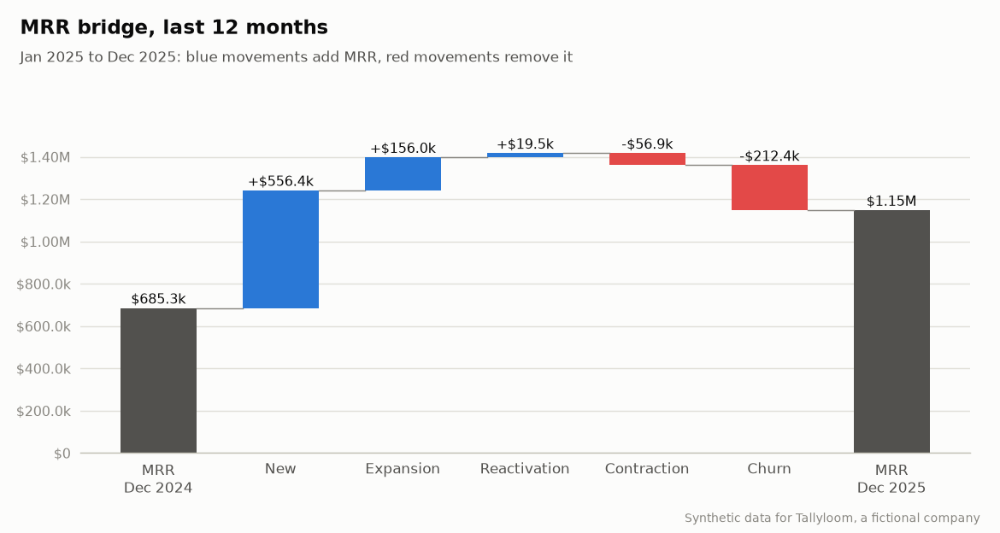
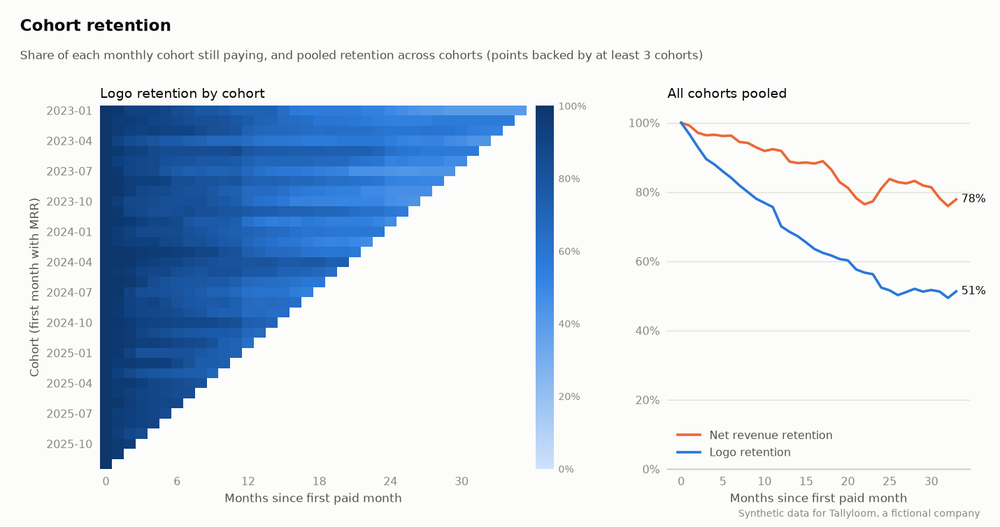
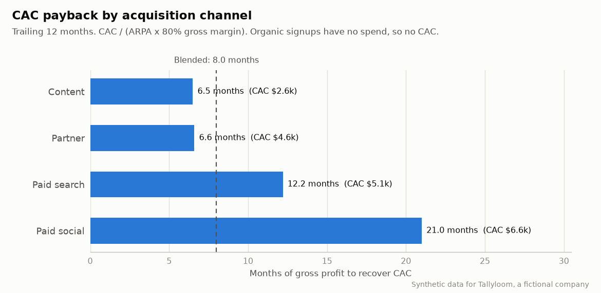

# saas-analytics-warehouse

Raw subscription, billing and marketing data in; reconciled, tested SaaS metrics out: MRR movements, cohort retention and unit economics, built with dbt on DuckDB.

[](https://github.com/ult666666/saas-analytics-warehouse/actions/workflows/ci.yml)


> **All data in this repository is synthetic.** It describes Tallyloom, a fictional B2B SaaS
> company invented for this project. Every number below comes from running `make all` with the
> default seed (42).

## Why

SaaS metrics look simple and are easy to get wrong. Annual plans have to be normalised to
monthly revenue, mid-month plan changes must not be double counted, a failed card payment is not
the same as a cancellation, and a customer who comes back is not a new customer. This project
builds the whole path from raw events to board-level metrics as a small warehouse, and tests
the accounting identities that make those metrics trustworthy. For example, the MRR bridge has to
reconcile to the cent in every month.

## What's inside

| Part | What it does |
| --- | --- |
| [`src/saasgen`](src/saasgen) | Seeded generator for eight raw tables: plans, marketing spend, signups, trials, customers, subscription events, invoices, payments. Deterministic and calibrated (pytest checks the generated rates). |
| [`dbt/`](dbt) | dbt-core + dbt-duckdb project: 8 staging, 4 intermediate and 9 mart models, 149 data tests and 2 unit tests. No external packages. |
| [`src/saasreport`](src/saasreport) | Queries the marts and writes the charts and [`reports/report.md`](reports/report.md). |
| [`docs/`](docs) | [Metric definitions](docs/METRICS.md) and [design notes](docs/DESIGN.md). |

Lineage, taken from dbt's manifest (sources on the left, report-ready marts on the right):



## Quick start

Requirements: [uv](https://docs.astral.sh/uv/) and `make`. uv installs Python 3.12 and every
dependency from `uv.lock`.

```bash
git clone https://github.com/ult666666/saas-analytics-warehouse.git
cd saas-analytics-warehouse
make all        # generate data -> dbt build (models + tests) -> report -> dbt docs
```

Output of `make all` (abridged; timings vary by machine):

```text
Generated synthetic Tallyloom data in 0.7s (seed=42, scale=1, 2023-01-01 to 2025-12-31)
  plans                       12 rows
  marketing_spend          4,384 rows
  signups                 24,694 rows
  trials                  17,193 rows
  customers                3,048 rows
  subscription_events      6,531 rows
  invoices                26,272 rows
  payments                28,914 rows
...
Finished running 1 seed, 17 table models, 149 data tests, 2 unit tests, 4 view models in 0 hours 0 minutes and 1.58 seconds (1.58s).
Done. PASS=173 WARN=0 ERROR=0 SKIP=0 NO-OP=0 REUSED=0 TOTAL=173
wrote reports/figures/mrr_trend.png
...
wrote reports/report.md
```

The warehouse is a single DuckDB file, `data/warehouse.duckdb`, with schemas `staging`,
`intermediate`, `marts` and `seeds`. `make docs` writes a self-contained dbt docs page to
`dbt/target/static_index.html`. Run `make help` to see every target.

### Investigate a month's churn

Trace the bridge to fictional customer records, payment-failure losses and channel/reason totals:

```bash
uv run python -m saasreport.churn --month 2024-12 --output-dir ../tallyloom-churn-2024-12
```

The read-only consumer validates exact customer-count, total-loss and payment-failure-subset
reconciliation before writing three CSVs and a Markdown investigation to a **new** directory.
It retains historical churn for customers who reactivated later and distinguishes a valid
zero-churn month from an absent month. See the [complete workflow and limits](docs/CHURN_INVESTIGATION.md)
and [real DuckDB regression tests](tests/test_churn.py). The selected month must exist in your build;
this example is covered by both the default build and the 24-month CI fixture.

## Key outputs

Synthetic data, December 2025 snapshot, from [`reports/report.md`](reports/report.md): ending MRR
**$1,147,877** from 2,068 paying customers (ARPA $555), up 67.5% over 2025 with a quick ratio of
2.72. Failed payments caused 35% of the MRR churned in 2025.







Unit economics over the trailing 12 months (`marts.rpt_unit_economics`, 80% gross margin
assumed):

| Channel | CAC | ARPA | Monthly logo churn | LTV | CAC payback | LTV:CAC |
| --- | ---: | ---: | ---: | ---: | ---: | ---: |
| Paid search | $5,131 | $526 | 2.71% | $15,520 | 12.2 months | 3.0x |
| Paid social | $6,560 | $391 | 3.27% | $9,580 | 21.0 months | 1.5x |
| Content | $2,642 | $505 | 3.28% | $12,308 | 6.5 months | 4.7x |
| Partner | $4,559 | $859 | 2.89% | $23,786 | 6.6 months | 5.2x |
| Organic | n/a | $442 | 3.12% | $11,322 | n/a | n/a |
| All channels (blended) | $3,332 | $518 | 2.99% | $13,868 | 8.0 months | 4.2x |

The full report adds the MRR trend, the funnel by channel and the MRR split by plan, including
how much MRR is still billed at pre-price-change list prices.

## Data quality

`dbt build` runs 149 data tests and 2 unit tests, and fails if any of them fails. Generic tests
(`unique`, `not_null`, `relationships`, `accepted_values`, plus the project's own
`unique_combination_of_columns` and `expression_is_true`) guard keys, foreign keys and allowed
values at every layer. Singular tests enforce the business invariants:

| Test | Invariant |
| --- | --- |
| `assert_mrr_bridge_reconciles` | Starting MRR + new + expansion + reactivation + contraction + churn = ending MRR in every month, ending MRR equals the sum of customer MRR, and customer counts roll forward the same way. |
| `assert_mrr_movements_exclusive_and_exhaustive` | Every customer-month whose MRR changed has exactly one movement, and it matches exactly one category definition: the one it is labelled with. |
| `assert_no_overlapping_subscription_periods` | A customer is never on two subscriptions at once. |
| `assert_logo_retention_at_most_100_pct` | Logo retention never exceeds 100% and is exactly 100% in month 0. |
| `assert_no_negative_mrr` | MRR is never negative at any grain. |
| `assert_mrr_matches_billing` | For every customer-month with MRR, the invoice in force, normalised to a month, equals that MRR. MRR comes from subscription events and invoices from billing, so this cross-checks two systems. |
| `assert_paid_invoices_have_one_successful_payment` | Paid invoices have exactly one successful charge; open and uncollectible invoices have none. This only holds after staging drops duplicate payment webhooks. |
| `assert_funnel_stages_only_narrow` | Trials never exceed signups and paid customers never exceed trials. |

The unit tests feed hand-written rows through `int_subscription_periods` and `fct_mrr_movements`
to pin down period boundaries, annual-to-monthly normalisation and every movement type. On the
Python side, 50 pytest tests cover generator determinism, referential integrity, date ordering,
billing consistency and calibration (generated rates against configured parameters), plus the
report, with 99% line and branch coverage.

## Metric definitions

Every metric is defined precisely in [docs/METRICS.md](docs/METRICS.md): formula, grain and edge
cases, such as mid-month plan changes, annual plans normalised to MRR, the reactivation rule,
failed payments and dunning, and the churn assumption behind LTV. The modelling choices and their
trade-offs are in [docs/DESIGN.md](docs/DESIGN.md).

## Development

```bash
make install   # uv sync --locked
make lint      # ruff check, ruff format --check, mypy --strict on src/, sqlfluff on dbt SQL
make test      # pytest with coverage (fails under 85%)
make data SCALE=0.25 MONTHS=24   # a smaller dataset; SEED=7 for a different one
```

- dbt runs from inside `dbt/`: `profiles.yml` lives there and its DuckDB and CSV paths are
  relative to that directory. The Makefile sets `DBT_PROFILES_DIR` and turns off dbt's anonymous
  usage tracking. For ad-hoc commands: `cd dbt && DBT_PROFILES_DIR=. uv run dbt build --select fct_mrr+`.
- CI ([`.github/workflows/ci.yml`](.github/workflows/ci.yml)) installs from the lockfile,
  generates a smaller dataset, runs `dbt build`, the report, pytest and the linters (ruff, mypy,
  sqlfluff with the Jinja templater).
- [`.github/workflows/pages.yml`](.github/workflows/pages.yml) publishes the static dbt docs to
  <https://ult666666.github.io/saas-analytics-warehouse/> on every push to `main`, with GitHub
  Pages set to use "GitHub Actions" as its source.

```text
src/saasgen/       data generator (config.py holds every simulation parameter)
src/saasreport/    charts and report.md from the marts
dbt/models/        staging/ -> intermediate/ -> marts/core/ and marts/reporting/
dbt/tests/         singular business-invariant tests and two generic tests
tests/             pytest suite
reports/           generated report.md and figures/ (committed)
docs/              METRICS.md, DESIGN.md
```

## Limitations and roadmap

Limitations:

- **Synthetic data.** Behaviour is designed in `src/saasgen/config.py`, not observed, so the
  numbers show the method, not market benchmarks.
- **Month-end snapshots.** MRR is measured on the last day of each month. A customer who cancels
  and returns within the same calendar month shows no churn or reactivation, and there is no
  daily MRR.
- **Simplified billing.** One subscription per customer; changes take effect at renewal (no
  proration); no discounts, coupons, taxes, refunds or currency conversion.
- **CAC is media spend only.** No salaries or tooling, first-touch attribution and no lag between
  spend and conversion. Gross margin is an assumed constant (80%) because the data has no cost of
  revenue. LTV assumes constant churn and is undiscounted.
- **DuckDB-specific SQL.** The date spine, `qualify` and `filter` clauses are written for DuckDB.
  Every model is a full refresh, and the schema-naming macro suits a single developer.
- **SQL linting checks templated style, not compiled SQL.** sqlfluff uses its Jinja templater
  with emulated dbt functions, so it is fast and needs no database, but it does not see the SQL
  dbt actually compiles.

Roadmap: incremental `fct_mrr` and snapshots of subscription state, multi-subscription and
proration support, MetricFlow semantic models, and a small dashboard on top of the marts.

## License

[MIT](LICENSE) © 2026 Charles Dai
