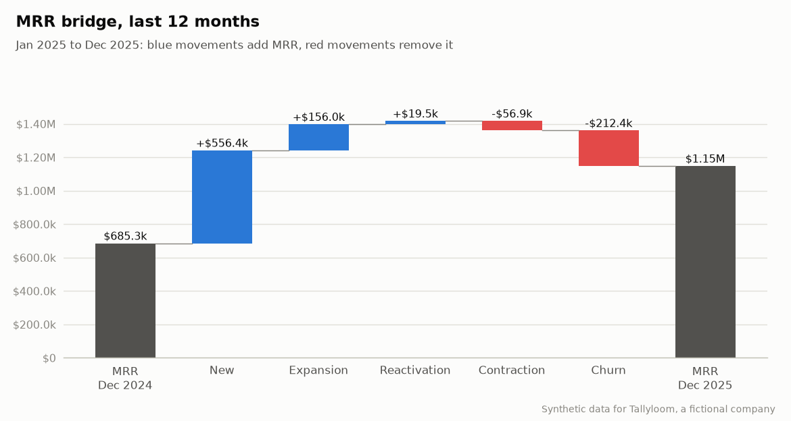

# saas-analytics-warehouse

A dbt project on DuckDB that turns raw subscription, billing and marketing data into
tested SaaS metrics: MRR movements, cohort retention and unit economics. The data
describes Tallyloom, a fictional B2B SaaS company, and comes from a seeded generator in
this repository, so every number below can be rebuilt with one command.

[](https://github.com/ult666666/saas-analytics-warehouse/actions/workflows/ci.yml)


```bash
git clone https://github.com/ult666666/saas-analytics-warehouse.git
cd saas-analytics-warehouse
make all        # generate data -> dbt build (models + tests) -> report -> dbt docs
```

You need [uv](https://docs.astral.sh/uv/) and `make`; uv installs Python 3.12 and every
dependency from `uv.lock`. The warehouse is one DuckDB file, `data/warehouse.duckdb`, and
the report is written to [reports/report.md](reports/report.md).

## Results

In December 2025, ending MRR is $1,147,877 from 2,068 paying customers. MRR grew 67.5%
over 2025, with a quick ratio (MRR gained over MRR lost) of 2.72. Failed card payments
caused 35% of the MRR churned that year.



Unit economics over the trailing 12 months, from `marts.rpt_unit_economics`, with an
assumed 80% gross margin:

| Channel | CAC | ARPA | Monthly logo churn | LTV | CAC payback | LTV:CAC |
| --- | ---: | ---: | ---: | ---: | ---: | ---: |
| Paid search | $5,131 | $526 | 2.71% | $15,520 | 12.2 months | 3.0x |
| Paid social | $6,560 | $391 | 3.27% | $9,580 | 21.0 months | 1.5x |
| Content | $2,642 | $505 | 3.28% | $12,308 | 6.5 months | 4.7x |
| Partner | $4,559 | $859 | 2.89% | $23,786 | 6.6 months | 5.2x |
| Organic | n/a | $442 | 3.12% | $11,322 | n/a | n/a |
| All channels (blended) | $3,332 | $518 | 2.99% | $13,868 | 8.0 months | 4.2x |

The [full report](reports/report.md) adds the MRR trend, cohort retention, CAC payback
by channel, the signup funnel and MRR by plan, including how much MRR is still billed at
pre-price-change list prices.

## How it is built

[`src/saasgen`](src/saasgen) writes eight raw tables as CSV files: plans, marketing
spend, signups, trials, customers, subscription events, invoices and payments. Its rates
are set in [`config.py`](src/saasgen/config.py), and pytest checks that the generated
data matches them. The [dbt project](dbt) builds four layers on top:

- staging, one model per source, which casts types, cleans hand-typed values and removes
  duplicate payment webhooks and old invoice versions;
- intermediate models for the date spine, subscription periods, the customer-month spine,
  the signup funnel and the current subscription state;
- a star schema of core marts, with `fct_mrr` (one row per customer-month) and
  `fct_mrr_movements`;
- reporting marts at the grain a chart needs, such as `rpt_mrr_bridge` and
  `rpt_cohort_retention`.

[`src/saasreport`](src/saasreport) reads the marts and writes the charts and the report.
Every metric has a written definition, with its grain and edge cases, in
[docs/METRICS.md](docs/METRICS.md). [docs/DESIGN.md](docs/DESIGN.md) has the model
lineage and the modelling decisions with their trade-offs.

The six event and daily feeds load incrementally, with a 7-day lookback for late rows. A
newer version of a row, such as an invoice that was open and is now paid, replaces the
old one through its unique key. A dbt snapshot keeps each customer's plan, seats, price,
MRR and status as a type 2 history, so the state on any past date is one query:

```sql
select customer_id, subscription_status, plan_code, seats, mrr_usd
from snapshots.snp_subscription_state
where dbt_valid_from <= timestamp '2025-06-30'
  and (dbt_valid_to is null or dbt_valid_to > timestamp '2025-06-30');
```

A full build records only the current state, and history accumulates with each load. To
watch it build up, and to check that loading day by day gives what a full refresh gives:

```bash
uv run saasgen --daily-batches data/batches   # the same rows, one folder per arrival day
make incremental-check                        # load day by day, build, compare (3m20s here)
make incremental-check MONTHS=6 SCALE=0.25 DAILY_DAYS=14   # the shorter run CI does
```

The check compares 24 relations, row by row, with a full refresh of the same files, and
with the default seed it reports `Incremental build equals the full refresh.` At this data
size incremental builds are not faster, because the sources are CSV files read in full;
DESIGN.md (decisions 14 to 16) explains why, and what the snapshot cannot record.

## Tests

`dbt build` runs 165 data tests and 3 unit tests and fails if any of them fails. Generic
tests guard keys, foreign keys and allowed values at every layer. Singular tests state the
business rules: starting MRR plus the month's movements equals ending MRR in every month,
each MRR change has exactly one movement type, and the MRR built from subscription events
matches what billing invoiced. The unit tests pin period boundaries, annual-to-monthly
normalisation, every movement type and the as-of boundary of the current state.

pytest covers the generator, the report and the churn investigation, and CI fails below
85% line and branch coverage. The [testing strategy](docs/DESIGN.md#testing-strategy)
lists every invariant, and the breaks used to check that the tests can fail.

## Investigate a month's churn

```bash
uv run python -m saasreport.churn --month 2024-12 --output-dir build/churn-2024-12
```

This traces one month of the bridge to the fictional customer records behind it: the
customers who churned, the losses from failed payments, and totals by channel and reason.
It checks that its customer counts and losses reconcile with the bridge before it writes
three CSV files and a Markdown summary to a new directory.
[docs/CHURN_INVESTIGATION.md](docs/CHURN_INVESTIGATION.md) covers the workflow and its
limits.

## Development

```bash
make install   # uv sync --locked
make lint      # ruff check, ruff format --check, mypy --strict on src/, sqlfluff on dbt SQL
make test      # pytest with coverage (fails under 85%)
make data SCALE=0.25 MONTHS=24   # a smaller dataset; SEED=7 for a different one
```

dbt runs from inside `dbt/`, where `profiles.yml` lives, and the Makefile sets
`DBT_PROFILES_DIR` for it. For ad-hoc commands:
`cd dbt && DBT_PROFILES_DIR=. uv run dbt build --select fct_mrr+`. `make help` lists every
target. CI builds a smaller dataset, runs `dbt build`, the report, the incremental load
check, pytest and the linters. A second workflow publishes the dbt docs to
<https://ult666666.github.io/saas-analytics-warehouse/> on every push to `main` (GitHub
Pages must use "GitHub Actions" as its source).

## Limits

- The data is synthetic, so the numbers show the method, not market benchmarks.
- MRR is measured at month end, so a customer who cancels and returns within one month
  shows neither churn nor reactivation.
- Billing is simplified: one subscription per customer, plan changes at renewal, and no
  proration, discounts, taxes or refunds.
- CAC counts media spend only, gross margin is an assumed 80%, and LTV assumes constant
  churn.
- Incremental runs miss rows more than 7 days late until a full refresh, and snapshot
  history starts at the first snapshot run.

[docs/DESIGN.md](docs/DESIGN.md#limitations-and-roadmap) has the full list and the
roadmap.

Built with AI coding assistants. The tests and CI checks described above verify its
behaviour.

## License

[MIT](LICENSE) © 2026 Charles Dai
