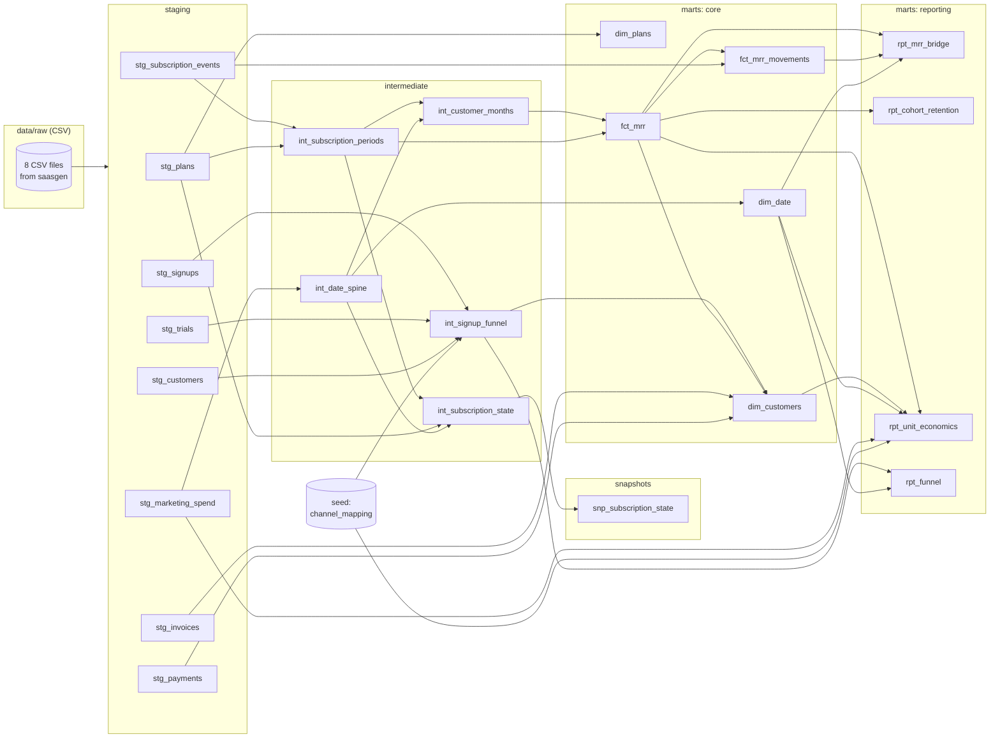

# Design notes

How the warehouse is put together and why. Each decision names the alternative that was not
chosen and what the choice costs.

## Pipeline at a glance

```
saasgen (Python)         data/raw/*.csv           8 raw tables, money in integer cents
   |
dbt sources              read_csv(..., all_varchar = true), via dbt-duckdb external_location
   |
staging        tables    1:1 with sources: types, names, cleaning, deduplication; the six event
                         feeds are incremental (decision 14)
intermediate   views     reusable logic: date spine, subscription periods, customer x month spine,
                         funnel, current subscription state
snapshots      table     SCD type 2 history of subscription state (decision 15)
marts/core     tables    star schema: dim_customers, dim_plans, dim_date, fct_mrr, fct_mrr_movements
marts/reporting tables   report-ready aggregates: rpt_mrr_bridge, rpt_cohort_retention, rpt_unit_economics, rpt_funnel
   |
saasreport (Python)      read-only DuckDB queries -> reports/figures/*.png + reports/report.md
```

Everything runs locally from one command (`make all`), in about 8 seconds on a laptop once the
dependencies are installed. CI runs the same steps on a smaller dataset, plus the load
simulation (decision 16).

### Model lineage

Taken from dbt's manifest, with sources on the left and report-ready marts on the right:



### A run of `make all`

The output of `make all` with the default seed, abridged (timings vary by machine):

```text
Generated synthetic Tallyloom data in 0.7s (seed=42, scale=1, 2023-01-01 to 2025-12-31)
  plans                       12 rows
  marketing_spend          4,384 rows
  signups                 24,694 rows
  trials                  17,193 rows
  customers                3,048 rows
  subscription_events      6,531 rows
  invoices                26,272 rows
  payments                28,914 rows
...
Finished running 6 incremental models, 1 seed, 1 snapshot, 11 table models, 165 data tests, 3 unit tests, 5 view models in 0 hours 0 minutes and 7.04 seconds (7.04s).
Done. PASS=192 WARN=0 ERROR=0 SKIP=0 NO-OP=0 REUSED=0 TOTAL=192
wrote reports/figures/mrr_trend.png
...
wrote reports/report.md
```

### Repository layout

```text
src/saasgen/       data generator (config.py holds every simulation parameter), daily batches
                   and the incremental load check (backfill.py)
src/saasreport/    charts and report.md from the marts
dbt/models/        staging/ -> intermediate/ -> marts/core/ and marts/reporting/
dbt/snapshots/     snp_subscription_state (SCD type 2)
dbt/tests/         singular business-invariant tests and two generic tests
tests/             pytest suite
reports/           generated report.md and figures/ (committed)
docs/              METRICS.md, DESIGN.md
```

## Layers and their contracts

| Layer | Materialisation | Contract |
| --- | --- | --- |
| Sources (`raw`) | external CSV | Exactly what the generator wrote. Every column is text. |
| Staging (`stg_`) | incremental or table | One model per source table, no joins. Casts types, renames to conventions, converts cents to dollars, normalises messy values (`utm_source`), removes duplicates (`stg_payments`) and old versions (`stg_invoices`). The six event and daily feeds are incremental; plans and customers are small tables. |
| Intermediate (`int_`) | view | Business logic that several marts reuse. Not meant for end users. |
| Core marts (`dim_`, `fct_`) | table | Kimball-style dimensions and facts at a stated grain. Explicit column lists. |
| Reporting marts (`rpt_`) | table | Aggregates at the grain a chart or table needs. Explicit column lists. |
| Snapshots (`snp_`) | snapshot | History that the sources do not keep. Only the snapshot holds state that a rebuild cannot recreate. |

The `rpt_` prefix keeps the "every model name starts with its layer" rule while separating
atomic facts (`fct_mrr`, one row per customer-month) from aggregates built on them
(`rpt_mrr_bridge`, one row per month).

## Naming conventions

- Models: `stg_<source table>`, `int_<what it builds>`, `dim_<entity>`, `fct_<process>`,
  `rpt_<report>`. One model per file, CTE-based SQL, lowercase keywords, snake_case.
- Columns: `<entity>_id` for keys, `*_at` for UTC timestamps, `*_date` for dates, `month_start`
  for monthly grain, `*_usd` for money, `*_rate` for ratios between 0 and 1, `is_*` or a verb
  (`started_trial`) for booleans.
- Schemas: `staging`, `intermediate`, `marts`, `seeds`. The `generate_schema_name` macro uses the
  folder's schema name as-is. dbt's default would produce `main_staging` and so on; the default is
  better in a shared warehouse where every developer needs their own prefix.

## Key decisions and trade-offs

**1. MRR comes from subscription events, not invoices.** Invoices answer "what did we bill",
while MRR answers "what is the recurring run-rate". An annual invoice is one large amount once a
year, and an invoice in dunning has not been paid yet. Events are turned into non-overlapping
periods (`int_subscription_periods`), and MRR is read from the period in force at each month end.
Invoices are then used to *test* MRR (`assert_mrr_matches_billing`), which cross-checks two
independent systems. That test caught a real subtlety while the project was being built: after
an involuntary cancellation, the unpaid annual invoice still nominally covers up to a year, so it
overlaps the invoice of a later reactivation. "The invoice in force" therefore has to mean the
most recent invoice covering the day.

**2. Month-end snapshot instead of daily MRR.** One snapshot per customer per month is simple,
standard in SaaS reporting and enough for a monthly bridge. The cost: changes that start and end
within one month are invisible, a subscription that starts on the 30th counts as a full month of
MRR, and one that ends on the 2nd counts as none. A daily grain would be about 30 times larger
and is rarely needed for board metrics.

**3. A gap-free customer x month spine.** `int_customer_months` gives every customer a row for
every month from their first subscription to the end of data, including months after churn.
Without it, `lag(mrr_usd)` would compare non-adjacent months for customers who churn and return,
and the bridge would stop reconciling. The bridge test exists to catch exactly that regression.

**4. Movements are derived from MRR deltas, not event labels.** An `upgrade` event does not
always produce an `expansion` (it might be followed by a failed payment), and a plan change and a
seat change can partly cancel out. Classifying the change in month-end MRR keeps the bridge
consistent with MRR by construction.

**5. Money is `decimal(18, 2)`, rounded once per period.** Floating-point sums of thousands of
values drift by fractions of a cent, and an equality test on a bridge would then fail randomly.
With decimals and a single rounding point (the `monthly_amount` macro), every sum is exact.

**6. Staging is materialised as tables, not views.** The CSV paths in the source definition are
relative to the `dbt/` directory. Views over them would only resolve when queried from that
directory, so the report (which runs from the repo root) could not read them. Tables make the
DuckDB file self-contained and parse each CSV once per build. On a cloud warehouse with real
source tables, staging views would be the usual choice.

**7. Raw data is read as text and typed explicitly in staging.** Letting `read_csv` infer types
would hide problems such as a date column becoming text because of one bad value. Explicit casts
fail loudly instead.

**8. The channel mapping is a seed.** Which `utm_source` belongs to which channel is business
data that marketing can review in a CSV. A `relationships` test from `stg_signups.utm_source` to
the seed fails the build when a new, unmapped source appears.

**9. The price lives on the subscription, not the plan.** Because of grandfathering, two Growth
customers can pay different prices on the same day. Events reference a `plan_price_id`, and
`dim_plans` is really a price book (plan x interval x version).

**10. Unit economics use a trailing 12-month window and first-touch attribution.** That matches
how a finance team reads CAC and payback. The trade-offs, such as spend timing, organic CAC and
constant churn, are listed in [METRICS.md](METRICS.md#unit-economics).

**11. No dbt packages.** The project writes its own `date_spine` macro (DuckDB's
`generate_series`), a `unique_combination_of_columns` test and an `expression_is_true` test,
instead of depending on `dbt_utils`. There is no `dbt deps` step and every line can be explained.
The cost is portability: `dbt_utils.date_spine` works on every warehouse, while this one only
works on DuckDB.

**12. dbt runs from inside `dbt/`.** dbt 1.12 does not change directory for `--project-dir`, so
relative paths in `profiles.yml` and the source definition resolve against the caller's working
directory. The Makefile always `cd`s into `dbt/` and sets `DBT_PROFILES_DIR`, so paths never
depend on where the command is typed. Anonymous usage tracking is disabled both in
`dbt_project.yml` and through an environment variable.

**13. sqlfluff with the Jinja templater.** `make lint` checks every model and singular test
with sqlfluff ([`dbt/.sqlfluff`](../dbt/.sqlfluff)): lowercase keywords, consistent indentation,
explicit join-condition order and explicit columns in tests. The Jinja templater emulates `ref`,
`source` and `var` and loads the project's macros, so linting takes a few seconds and needs no
warehouse. The dbt templater would lint the exact compiled SQL but needs a working dbt
connection, and it is slower and more fragile across dbt versions. Rule ST06 (simple columns
before calculated ones) is disabled because the models order columns by meaning instead.
Satisfying the linter also replaced two multi-line `qualify` clauses with a `row_number()`
column filtered in the next CTE, which is the more portable pattern.

**14. The event feeds are incremental: `delete+insert` on a unique key, with a lookback
window.** `stg_signups`, `stg_trials`, `stg_subscription_events`, `stg_invoices`,
`stg_payments` and `stg_marketing_spend` are dbt incremental models. On an incremental run,
the `incremental_lookback` macro keeps the source rows whose timestamp is at most
`incremental_lookback_days` (7) older than the newest row already loaded. The model removes
duplicates within that window (the first delivery of a payment, the newest version of an
invoice), and the `delete+insert` strategy deletes the loaded rows with the same unique key
before inserting the new ones. A late row is therefore picked up if it is at most a week late,
and a row seen twice replaces its earlier copy instead of duplicating it. The four strategies
dbt-duckdb offers:

| Strategy | Why not (or why) |
| --- | --- |
| `append` | Every lookback run would insert the window again. With `append`, the load simulation below ends with 563 invoice rows against 254 in a full refresh, and `unique_stg_invoices_invoice_id` fails. |
| `merge` | Works (DuckDB 1.4 and later run `MERGE`), with the same result here. `delete+insert` is dbt-duckdb's long-standing strategy for a unique key and works on every DuckDB 1.x. |
| `microbatch` | Rebuilds whole event-time batches. It suits append-only facts, but an invoice's two versions have different `updated_at` days, so both would survive in different batches; replacing by `invoice_id` needs a unique key. It also takes its batch bounds from the wall clock, which a simulation of past days would have to override. |
| `delete+insert` | Chosen: replace by key, simple semantics, and a window that one variable controls. |

*The lookback trade-off.* A longer window absorbs later arrivals but reprocesses more rows on
every run. A row that arrives later than the window is missed until the next full refresh,
silently: nothing in an incremental run fails. The generator delays rows by at most 5 days
(`MAX_ARRIVAL_DELAY_DAYS`), and a row can land up to a day after its own timestamp, so 7 days
covers every late row with a day to spare. With a window of 0 days, the load simulation's
CI configuration misses two late signups, two relationship tests fail on the incremental
warehouse, and five relations differ from the full refresh (`stg_signups` and everything
built on it). Choosing the window is choosing how late data may be. A production pipeline
would measure the arrival delay per source and alert on rows older than the window, which
this project does not do. Filtering on an ingestion timestamp instead of the event time
(as `stg_payments` does, because `received_at` is when the webhook arrived) removes the
lateness problem for that source, but most sources do not record one.

*What stays a full rebuild, and why.* The marts and intermediate models rebuild from the
staging tables on every run. `fct_mrr` needs each customer's whole history for `lag()` and the
cohort month, and its 50,884 rows took 0.38 seconds to build in a `make data build` here. An incremental
`fct_mrr` would rebuild only the months from the earliest changed effective date onwards and
would need the previous month from the target table; it stays on the roadmap.

*Measured cost.* In `uv run python -m saasgen.backfill` with the default dataset (36 months),
dbt took 2.3 seconds for the initial build of 1,065 days without the data tests, and a median
of 2.3 seconds for each of the 31 daily incremental builds that followed (5.4 seconds of wall
clock time each, including dbt's start-up). The full refresh of the same data, with every
test, took 6.1 seconds. So at this size incremental builds save nothing. The sources are CSV
files that DuckDB parses in full on every run, so an incremental run saves only the writes,
and at about 112,000 raw rows those take milliseconds. The pattern pays off when the source is
a large table that the warehouse can prune by event time, so a run reads a week of data
instead of all of it. The simulation shows the mechanics are correct; it does not show a
speed-up, and the README does not claim one.

**15. Subscription history is a snapshot of a current-state model, on business time.** The
sources keep events, not a mutable subscription table, so the history could always be
rebuilt from them. The snapshot is there for the common case where a source only shows the
present (an app database's `subscriptions` table), and `int_subscription_state` plays that
source: one row per customer with the plan, seats, price, MRR and status in force on the last
day of data. `snp_subscription_state` snapshots it with dbt's **timestamp strategy**, and
`updated_at` is `state_started_at`, the day the state took effect. The validity windows are
therefore business dates, not load times, and "what was this customer's plan on 14 March?"
is the version with `dbt_valid_from <= '2024-03-14' < dbt_valid_to`. The alternative, the
check strategy, would stamp each version with the time `dbt snapshot` ran. That is useful for
auditing what the warehouse knew when, but it is not reproducible and it answers a different
question.

What a snapshot cannot do: history starts at the first snapshot run (a full build records
only each customer's current state), and it records only the states it sees. If a late event
is already superseded by a newer one when it arrives, that brief state never appears, and
`dbt snapshot` ignores a source row whose `updated_at` is older than the current version.
Four tests guard the history: windows of one customer never overlap and leave no gaps, each
customer has exactly one current version, the current versions equal `int_subscription_state`,
and every version in force on a month end agrees with `fct_mrr` (rebuilt from the full event
log). A snapshot is the one stateful object in the warehouse, so `make data` deletes the
warehouse file: history from one generated dataset means nothing for another.

**16. Incremental correctness is proved by comparison, not assumed.** `saasgen --daily-batches`
writes the same seeded rows as daily batches: each row on the day it becomes known and an
invoice once when issued and again when its status changes. A seeded 3% of the rows that can
be late (signups, trials, customers, subscription events and invoice versions) arrive one to
five days late, from a separate random stream, so the data itself does not change; payments,
plans and marketing spend always arrive on time. With the defaults (seed 42, 36 months, scale
1), `uv run saasgen --daily-batches data/batches` writes 1,096 batches with 112,415 rows, 2,366
of them late.
`python -m saasgen.backfill` loads an initial period at once, then one day at a time,
running `dbt build` without the data tests after each day (mid-load, a late row can refer to a
row that has not arrived yet), then every test. It then builds a second warehouse from the
same files with `--full-refresh` and compares every model and seed, and the snapshot's
current versions, row by row: the row counts must match and an `except all` in each direction
(a multiset difference, so row order does not matter and duplicates count) must be empty. On a
mismatch it prints up to three differing rows from each side. Floating-point columns are compared rounded to 10 decimal places, because
parallel aggregation can change their last bits; everything else must match exactly. CI runs
a short version (6 months, the last 14 days one at a time) on every push.

## Testing strategy

| Level | Tool | What it proves |
| --- | --- | --- |
| Generator | pytest (`tests/test_generator.py`) | Same config gives byte-identical files; keys and foreign keys hold; timestamps are ordered (signup <= trial <= conversion; occurred_at <= effective_date); event sequences follow the subscription state machine; invoices match the price book; generated rates land within tolerance of the configured parameters. |
| Source contracts | dbt generic tests on staging | Keys are unique and present, foreign keys resolve, categorical values are in their accepted sets, amounts are non-negative, cancel events and only cancel events have no price. |
| Business invariants | dbt singular tests (`dbt/tests/`) | The bridge reconciles, movements are exclusive and exhaustive, periods never overlap, retention is bounded, MRR is non-negative, billing agrees with MRR, payments agree with invoices, funnels only narrow. |
| Transformation logic | dbt unit tests | Hand-written inputs for `int_subscription_periods` and `fct_mrr_movements` produce the expected rows, including annual normalisation and every movement type. |
| Report | pytest (`tests/test_report.py`) | The report renders from a miniature copy of the marts, is byte-for-byte reproducible and refuses a bridge that does not reconcile. |
| Daily batches | pytest (`tests/test_batches.py`) | Loading every batch gives back the dataset (the newest version of each invoice); no row arrives before it is known or more than 5 days late; the late share is within 4 standard deviations of 3%; invoices get a second version exactly when their status changes. |
| Load simulation | pytest (`tests/test_backfill.py`) and `make incremental-check` | Landing, the warehouse comparison and the order of steps (with a fake dbt); then, for real, an incremental build that equals a full refresh. |
| History | dbt singular tests and a unit test | Snapshot windows are contiguous, one current version per customer, current versions equal the current-state model, history agrees with `fct_mrr` at every month end, and the state model's as-of boundary. |

Tests are only useful if they can fail, so the main ones were checked by breaking the model on
purpose:

- Changing one expected value in either unit test makes it fail.
- Computing `lag()` over a spine with gaps (dropping zero-MRR months before the window function)
  makes `assert_mrr_bridge_reconciles` fail in 35 of the 36 months.
- Labelling reactivations as `new` makes `assert_mrr_movements_exclusive_and_exhaustive` fail on
  exactly the 94 reactivation rows. The unit test catches the same bug first.
- A lookback window of 0 days makes the load simulation fail (decision 14): two late signups
  are missed, two relationship tests fail and five relations differ from the full refresh.
- The `append` strategy instead of `delete+insert` on `stg_invoices` makes it fail too:
  `unique_stg_invoices_invoice_id` fails and the table holds 563 rows instead of 254.
- Treating a period that ends on the last day as still active makes
  `assert_snapshot_history_matches_month_end_mrr` fail on 2 customer-months (with the unit
  tests excluded), and the `int_subscription_state` unit test fails on its own.

The singular tests restate definitions instead of re-running the model's own SQL. For example,
`assert_mrr_movements_exclusive_and_exhaustive` writes the five movement conditions out again,
so a bug in the model's `case` expression cannot also hide in the test.

### Data tests and the invariants they enforce

`dbt build` runs 165 data tests and 3 unit tests, and fails if any of them fails. Generic tests
(`unique`, `not_null`, `relationships`, `accepted_values`, plus the project's own
`unique_combination_of_columns` and `expression_is_true`) guard keys, foreign keys and allowed
values at every layer. Singular tests enforce the business invariants:

| Test | Invariant |
| --- | --- |
| `assert_mrr_bridge_reconciles` | Starting MRR + new + expansion + reactivation + contraction + churn = ending MRR in every month, ending MRR equals the sum of customer MRR, and customer counts roll forward the same way. |
| `assert_mrr_movements_exclusive_and_exhaustive` | Every customer-month whose MRR changed has exactly one movement, and it matches exactly one category definition: the one it is labelled with. |
| `assert_no_overlapping_subscription_periods` | A customer is never on two subscriptions at once. |
| `assert_logo_retention_at_most_100_pct` | Logo retention never exceeds 100% and is exactly 100% in month 0. |
| `assert_no_negative_mrr` | MRR is never negative at any grain. |
| `assert_mrr_matches_billing` | For every customer-month with MRR, the invoice in force, normalised to a month, equals that MRR. MRR comes from subscription events and invoices from billing, so this cross-checks two systems. |
| `assert_paid_invoices_have_one_successful_payment` | Paid invoices have exactly one successful charge; open and uncollectible invoices have none. This only holds after staging drops duplicate payment webhooks. |
| `assert_funnel_stages_only_narrow` | Trials never exceed signups and paid customers never exceed trials. |
| `assert_snapshot_windows_are_contiguous` | A customer's snapshot versions never overlap and leave no gaps. |
| `assert_snapshot_has_one_current_version_per_customer` | Exactly one current version per customer. |
| `assert_snapshot_matches_current_state` | The current versions equal `int_subscription_state`. |
| `assert_snapshot_history_matches_month_end_mrr` | Every version in force on a month end agrees with `fct_mrr`, which is rebuilt from the full event log. |

The unit tests feed hand-written rows through `int_subscription_periods`, `fct_mrr_movements`
and `int_subscription_state` to pin down period boundaries, annual-to-monthly normalisation,
every movement type and the as-of boundary of the current state. On the
Python side, pytest covers generator determinism, referential integrity, date ordering, billing
consistency and calibration (generated rates against configured parameters), plus the report and
the churn investigation. CI reports line and branch coverage on every run and fails below 85%.

## How the synthetic data is made

- One `numpy.random.Generator` per stage, derived with `SeedSequence(seed).spawn()`, so changing
  how billing is simulated does not reshuffle the signups.
- Every parameter (prices, conversion rates, churn by plan and company size, expansion ramp,
  dunning schedule) lives in [`src/saasgen/config.py`](../src/saasgen/config.py). The tests
  compare generated rates with these values.
- Realistic imperfections are added on purpose, so staging has real work to do: hand-typed
  `utm_source` values with odd case and whitespace (3%), duplicate payment webhooks (0.5%), and
  invoices still `open` because their retries fall after the last day of data.
- Plausibility was checked against typical SMB SaaS shapes: about 3% monthly logo churn,
  roughly 70% of a cohort still paying after 12 months, a CAC payback of about 6 to 21 months
  depending on channel, and a visible drop at month 12 when annual contracts come up for renewal.

## Common questions

- *Why is MRR measured at month end, and what happens to a plan change on the 15th?* The state on
  the last day counts for the whole month; see decision 2.
- *How do you know the MRR bridge is right?* It is an identity (starting + movements = ending)
  enforced by a test every build, and MRR is cross-checked against invoices.
- *What is the difference between churn and contraction, and between new and reactivation?* See
  the movement table in [METRICS.md](METRICS.md#mrr-movements).
- *Why does logo retention never exceed 100% when NRR can?* Logo retention counts a subset of the
  cohort; NRR compares money, and expansion can outgrow losses.
- *How would you make `fct_mrr` incremental?* Rebuild only the months on or after the earliest
  effective date that changed (late-arriving or backdated events), and use
  `is_incremental()` with a delete+insert strategy by month. It would need the previous month's
  MRR and each customer's cohort month from the target table (decision 14).
- *How do you know the incremental build is right?* The load simulation builds it day by day
  and compares it row by row with a full refresh of the same data, in CI (decision 16).
- *How late can data be?* At most `incremental_lookback_days` (7) before the newest loaded
  row; later rows are missed until a full refresh. That bound is a choice, see decision 14.
- *What does the snapshot know that the events do not?* Nothing here, which is what makes it
  testable: its history is checked against `fct_mrr`. With a source that only shows the
  present, the snapshot would be the only record of the past.
- *What breaks on a real warehouse?* `generate_series`, `qualify` and `filter` are not portable
  everywhere; `dbt_utils.date_spine` and `case when` aggregates would replace them.
- *What would you add next?* An incremental `fct_mrr`, proration, multiple subscriptions per
  customer and a semantic layer for metric definitions.

## Limitations and roadmap

- Synthetic data. Behaviour is designed in `src/saasgen/config.py`, not observed, so the
  numbers show the method, not market benchmarks.
- Month-end snapshots. MRR is measured on the last day of each month. A customer who cancels
  and returns within the same calendar month shows no churn or reactivation, and there is no
  daily MRR.
- Simplified billing. One subscription per customer; changes take effect at renewal (no
  proration); no discounts, coupons, taxes, refunds or currency conversion.
- CAC is media spend only. No salaries or tooling, first-touch attribution and no lag between
  spend and conversion. Gross margin is an assumed constant (80%) because the data has no cost of
  revenue. LTV assumes constant churn and is undiscounted.
- DuckDB-specific SQL. The date spine, `qualify` and `filter` clauses are written for DuckDB,
  and the schema-naming macro suits a single developer.
- Late data is bounded by the lookback window. A row more than 7 days older than the newest
  loaded row is missed by incremental runs until a full refresh, and nothing alerts on it. The
  marts are still full rebuilds, and because the sources are CSV files read in full, incremental
  runs are not faster at this size.
- Snapshot history starts at the first snapshot run and holds only the states a run saw: a
  late change that was already superseded when it arrived never appears.
- SQL linting checks templated style, not compiled SQL: sqlfluff uses its Jinja templater
  with emulated dbt functions, so it is fast and needs no database, but it does not see the SQL
  dbt actually compiles.

### Roadmap

An incremental `fct_mrr`, multi-subscription and proration support, MetricFlow semantic
models, and a small dashboard on top of the marts.
