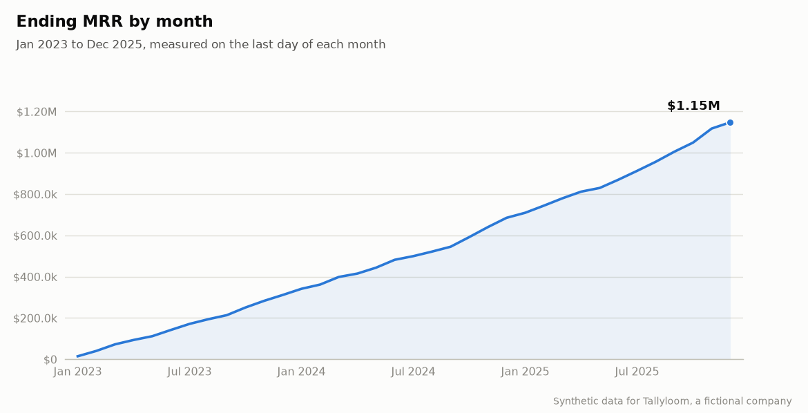
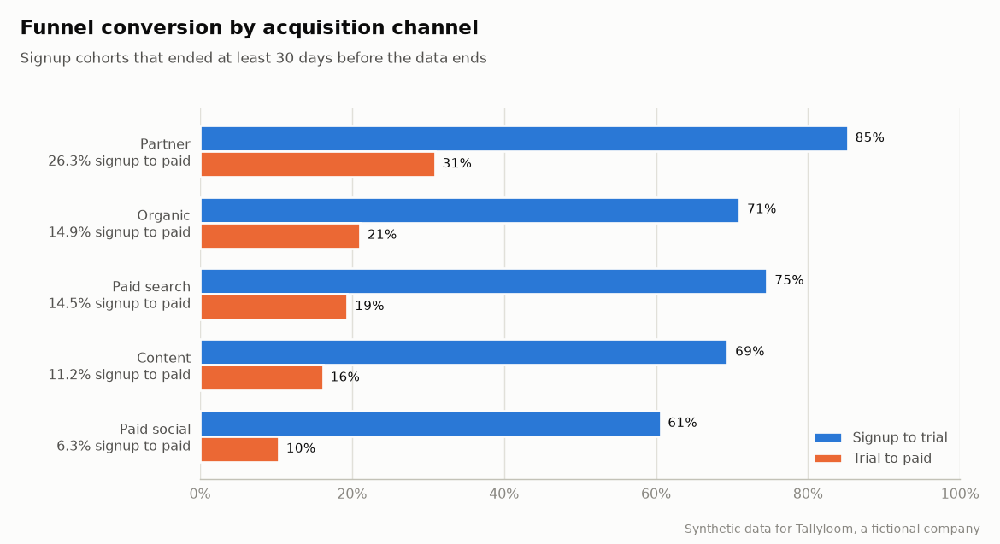

# Tallyloom metrics report

> **All data is synthetic.** Tallyloom is a fictional SaaS company; every number below
> comes from data generated by `saasgen` and transformed by the dbt marts in this
> repository. Regenerate this file with `make report`.

Data covers Jan 2023 to Dec 2025. MRR is measured on the last day of each month.

## Headline (Dec 2025)

| Metric | Value |
| --- | ---: |
| Ending MRR | $1,147,877 |
| ARR (MRR x 12) | $13,774,524 |
| Paying customers | 2,068 |
| ARPA (MRR per paying customer) | $555 |
| MRR growth, Jan 2025 to Dec 2025 | +67.5% |
| Net new MRR, Jan 2025 to Dec 2025 | +$462,598 |
| Quick ratio, Jan 2025 to Dec 2025 | 2.72 |
| Average monthly logo churn, Jan 2025 to Dec 2025 | 2.99% |

## MRR bridge, Jan 2025 to Dec 2025

| Movement | MRR |
| --- | ---: |
| Starting MRR (end of Dec 2024) | $685,279 |
| New | +$556,409 |
| Expansion | +$156,046 |
| Reactivation | +$19,475 |
| Contraction | -$56,929 |
| Churn | -$212,404 |
| Ending MRR (end of Dec 2025) | $1,147,877 |

Failed payments (involuntary churn) caused 35% of the churned MRR in this period.

## Cohort retention

| Months since start | Cohorts | Logo retention | Net revenue retention |
| --- | ---: | ---: | ---: |
| 1 | 35 | 96.7% | 99.2% |
| 3 | 33 | 89.5% | 96.4% |
| 6 | 30 | 84.1% | 96.3% |
| 12 | 24 | 70.1% | 91.9% |
| 24 | 12 | 52.4% | 81.0% |

Rates are pooled over every cohort old enough to reach that month (ratio of sums).

## Unit economics, trailing 12 months

| Channel | Spend | New customers | CAC | ARPA | Monthly logo churn | LTV | Payback (months) | LTV:CAC |
| --- | ---: | ---: | ---: | ---: | ---: | ---: | ---: | ---: |
| Paid search | $1,990,754 | 388 | $5,131 | $526 | 2.71% | $15,520 | 12.2 | 3.0x |
| Paid social | $1,180,792 | 180 | $6,560 | $391 | 3.27% | $9,580 | 21.0 | 1.5x |
| Content | $314,371 | 119 | $2,642 | $505 | 3.28% | $12,308 | 6.5 | 4.7x |
| Partner | $556,226 | 122 | $4,559 | $859 | 2.89% | $23,786 | 6.6 | 5.2x |
| Organic | $0 | 404 | n/a | $442 | 3.12% | $11,322 | n/a | n/a |
| All channels (blended) | $4,042,142 | 1,213 | $3,332 | $518 | 2.99% | $13,868 | 8.0 | 4.2x |

LTV = ARPA x 80% gross margin / monthly logo churn (constant churn, undiscounted). Organic customers have no attributed spend, so CAC is n/a.

## Funnel conversion

| Channel | Signups | Trials | Paid | Signup to trial | Trial to paid | Signup to paid |
| --- | ---: | ---: | ---: | ---: | ---: | ---: |
| Paid search | 7,189 | 5,364 | 1,040 | 74.6% | 19.4% | 14.5% |
| Paid social | 6,846 | 4,146 | 429 | 60.6% | 10.3% | 6.3% |
| Content | 2,620 | 1,819 | 294 | 69.4% | 16.2% | 11.2% |
| Partner | 1,238 | 1,055 | 326 | 85.2% | 30.9% | 26.3% |
| Organic | 6,052 | 4,296 | 904 | 71.0% | 21.0% | 14.9% |

Only signup cohorts that ended at least 30 days before the data ends are included.

## MRR by plan (Dec 2025)

| Plan | Customers | MRR | Share of MRR | Still on pre-change price |
| --- | ---: | ---: | ---: | ---: |
| Starter | 614 | $46,560 | 4.1% | 15.1% |
| Growth | 1,010 | $400,235 | 34.9% | 26.5% |
| Enterprise | 444 | $701,082 | 61.1% | 32.5% |

Existing subscriptions keep their price after the list-price change until they change plan (grandfathering).
